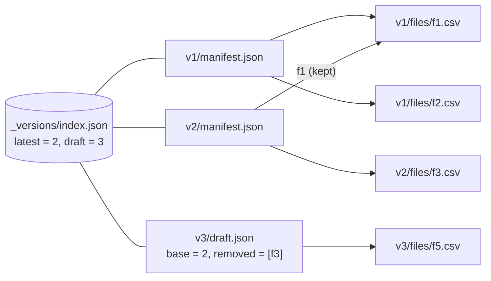
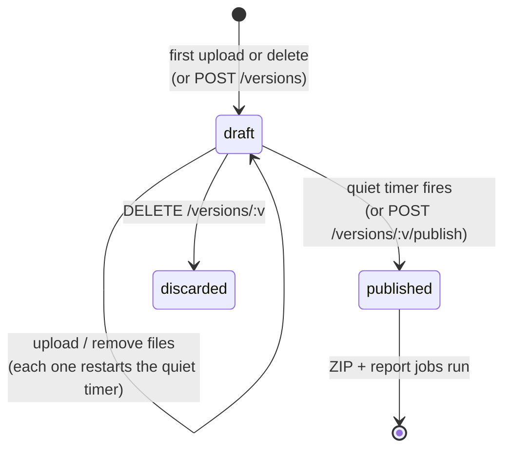
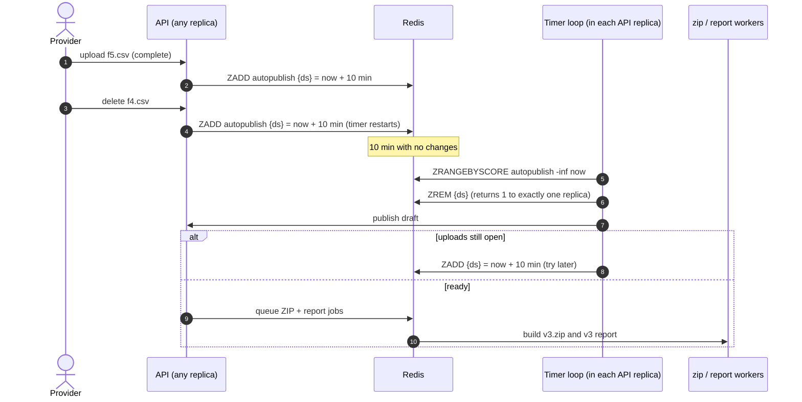

# Dataset Versioning — Plan

**Approach:** layered version folders + one manifest per version

## Idea

Each file is stored once, under the version it was uploaded in. Each version has a manifest
listing all its files; files kept from an older version just point at the older storage key.
No copies, no new database.



## Layout

```text
{ds}/f1.csv …                          legacy files (become v1, untouched)
{ds}/_versions/index.json              versions, latest, open draft
{ds}/_versions/vN/manifest.json        written once at publish
{ds}/_versions/vN/draft.json           while draft: base version + removed paths
{ds}/_versions/vN/files/{path}         files uploaded in vN
zips/{ds}/vN.zip                       per-version ZIP
reports/{ds}/vN/data_readiness_report.pdf
zips/{ds}.zip, reports/{ds}/…pdf       kept updated for latest (old links keep working)
```

Manifest entry: `{ path, key, size, etag, contentType, addedIn }`.

## Lifecycle



- One open draft per dataset; it's visible only to the owner.
- The first file change after a publish opens a draft automatically.
- Draft file list = base version's files − removed + whatever is under `vN/files/` (found by listing at publish).
- Publish: refuse if uploads are still open, write the manifest, set `latest`, queue ZIP + report.
- Published versions never change.

## Automatic publishing (replaces the frontend calling `/process`)

Every add or delete restarts a per-dataset quiet timer. When nothing has changed for
`AUTO_PUBLISH_QUIET_SECONDS` (default 600), the server publishes the draft, which builds the ZIP
and report. The frontend never calls `/process` or publish; manual publish stays available to
skip the wait.

No storage event notifications are needed: every write already goes through the API, because the
`/query-access` credentials are read-only (`s3:GetObject`).



| Rule | Detail |
|---|---|
| What restarts the timer | Upload started, upload completed, upload cancelled, file removed. |
| Timer store | Redis sorted set `autopublish`: member = dataset ID, score = due time. `ZADD` overwrites, so the latest change wins. Survives API restarts. |
| Who fires it | A loop in every API replica, every 15 s. `ZREM` returns 1 to only one replica, so a dataset is published once. |
| Uploads still open | Publish is postponed by another quiet period. Uploads open longer than `AUTO_PUBLISH_STALE_UPLOAD_HOURS` (default 24) are aborted so they can't block forever. |
| Nothing actually changed | (e.g. a file added then removed) The draft is discarded and no version is made. |
| Publish fails | Logged, audited, retried after another quiet period. |
| Settings | `AUTO_PUBLISH_ENABLED`, `AUTO_PUBLISH_QUIET_SECONDS`, `AUTO_PUBLISH_STALE_UPLOAD_HOURS`. |

## API

- **New:** `GET/POST /versions`, `GET/PATCH/DELETE /versions/:v`, `POST /versions/:v/publish`,
  `GET /versions/:a/diff/:b`, `POST /versions/:v/outputs` (re-run ZIP/report).
- **Existing routes:**
  - Optional `version` on list, download, preview, metadata, ZIP download and report download. It defaults to latest.
  - Uploads go to the draft (opening one if needed) and restart the quiet timer.
  - Delete only works on a draft and restarts the quiet timer.
  - `/process` stays for manual re-runs; the frontend no longer needs to call it.
- **Auth:** same checks as today. Writes are owner-only; drafts are never readable through public routes.

## Components

| Where | Change |
|---|---|
| `src/services/version-service.ts` (new) | Index/manifest read-write, resolve path → key, publish, adopt legacy datasets |
| `src/routes/versions-routes.ts` (new) | Version endpoints |
| `src/services/auto-publish-scheduler.ts` (new) | Restart the per-dataset quiet timer in Redis; loop that claims due datasets and publishes them |
| `src/routes/databanks-routes.ts` | `version` param; uploads → draft; delete → draft only |
| Storage repositories | Conditional put (S3/MinIO `If-Match`/`If-None-Match`, GCS `ifGenerationMatch`); list open uploads by prefix |
| `job-queue.ts` | Jobs carry `options.version` + `options.manifestKey` |
| zip-worker, report-worker | Read files from the manifest; write `vN` outputs; update legacy keys + Catalogue only if latest |

## Key rules

- **Concurrent updates:** the index is only written if unchanged since it was read; a lost race re-reads and retries. Fall back to a Redis lock if storage lacks conditional writes.
- **Existing datasets:** become v1 the first time they're used with versions. The v1 manifest points at the current files; nothing is moved.
- **Old workers:** jobs without `version` behave exactly as today, so ship workers before turning the flag on.
- **Feature flag:** `DATASET_VERSIONING_ENABLED` (off = today's behaviour).

## Decisions

1. Drafts open automatically on the first change and publish automatically after a 10-minute quiet period (`AUTO_PUBLISH_QUIET_SECONDS`). `POST /versions` and manual publish stay available.
2. Anyone with access can read any published version.
3. All published versions are kept; only drafts can be discarded.
4. Names are `v1, v2…` plus an optional label and notes.
5. `/query-access` stays scoped to `{ds}/*` and also returns the path → key map.
6. The Catalogue gets only the latest version's ZIP size and readiness score.

## Build order

1. Storage: conditional writes and listing open uploads (S3, MinIO, GCS).
2. Workers: read from the manifest and write per-version outputs.
3. API, behind the flag: VersionService, version routes, draft-aware uploads and deletes, `version` on read routes.
4. Auto-publish: quiet timer in Redis and the publish loop, behind `AUTO_PUBLISH_ENABLED`.
5. OpenAPI, endpoint docs, uploader script and Postman; end-to-end tests on MinIO and GCS.
