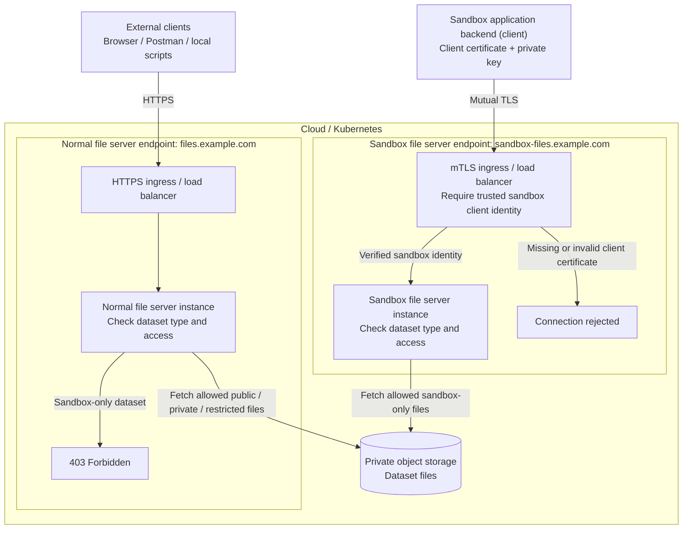
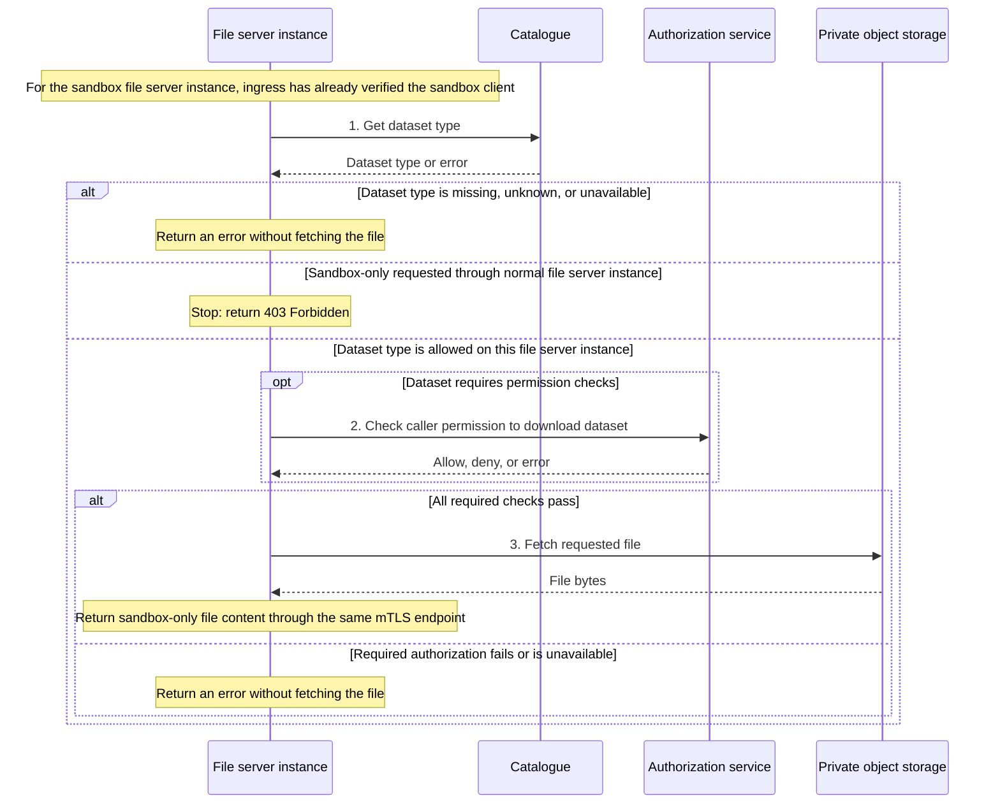

# mTLS-Based File Server Architecture

**Design proposal:** the architecture below describes the intended deployment and access rules.
The current application and example manifests do not yet enforce all of these rules.

Deploy the same application as two independently configured file server instances in the cloud
or Kubernetes, each with its own hostname, ingress/load balancer, and backend service:

- **Normal file server instance:** `files.example.com`, using HTTPS. Serves public, private,
  and restricted datasets according to their access policies. Always rejects sandbox-only reads.
- **Sandbox file server instance:** `sandbox-files.example.com`, using mutual TLS (mTLS).
  Its ingress verifies the sandbox client's certificate and that the client holds the matching
  private key before forwarding requests. The file server then checks dataset permissions.

The **sandbox application backend** is the client that requests files. The **sandbox file server
instance** is the cloud service that serves those requests. They are separate components.

Here, “sandbox origin” means a verified sandbox client identity. It is not the HTTP `Origin`
header, a CORS setting, or a client-provided flag. Keep the client private key inside the sandbox
application backend. A local Postman client without valid sandbox credentials cannot connect
to the sandbox file server endpoint. A client holding valid sandbox credentials can authenticate
regardless of where it runs.

## High-level architecture

This diagram shows the request paths. Both file server instances consult the shared Catalogue
and authorization services before fetching data; those checks are expanded in the flow below.
Responses return through the same endpoint that accepted the request.



Any caller attempting the sandbox file server endpoint must pass its mTLS checks, including
external clients that know its hostname. Certificate verification happens before the application
reads the dataset ID, so this endpoint requires mTLS for every connection.

## Dataset access rules

| Dataset type | Normal file server instance (HTTPS) | Sandbox file server instance (mTLS) |
| --- | --- | --- |
| Public | Allow according to public policy | Optional; apply the same dataset policy |
| Private | Check the caller's dataset permissions | Optional; check the same dataset permissions |
| Restricted | Check the caller's dataset permissions | Optional; check the same dataset permissions |
| Sandbox-only | Always deny | Require verified sandbox identity and permission to download the dataset |

Supporting other dataset types on the sandbox file server instance is optional. The proposed
dedicated sandbox path above shows sandbox-only reads. The distinction between private and
restricted permissions remains defined by the existing authorization policy.

For sandbox-only content, all of the following must hold:

```text
allow = request reached the sandbox file server endpoint
        AND sandbox client identity was verified
        AND caller has dataset access
```

The normal file server instance must reject sandbox-only reads even if the user has permission
to download the dataset. It must not forward a sandbox-only download using its own client
certificate. If the dataset type is missing, unknown, or cannot be retrieved, do not allow a download.

## Download flow

The Catalogue tells the file server the dataset type. The authorization service checks the caller's
dataset permissions. Object storage holds the files. The file server fetches a file only after
the dataset type and all required permissions allow the download.



## Deployment and download requirements

- Both file server instances may share Catalogue, authorization services, and private object storage.
  Separate Kubernetes Services and deployment selectors must keep the two request paths distinct.
- The sandbox ingress must validate the client certificate chain and authorize the sandbox
  identity using a dedicated client CA or an explicit identity policy. The sandbox client must
  also validate the server certificate. Plan certificate rotation and keep keys in protected
  runtime secrets.
- When the ingress/load balancer performs mTLS verification, allow only that component to reach
  the sandbox file server instance. Remove any client-supplied certificate identity headers before
  forwarding the verified identity. Protect the connection between the ingress and the file server.
- Return sandbox-only file content through the sandbox file server endpoint (streaming).
  A presigned URL is a temporary link that lets its holder download directly from object storage.
  An externally usable link would bypass mTLS, even if obtaining it required mTLS. Direct storage
  downloads need equivalent sandbox access checks before they can be used.
- Apply the sandbox-only rule to every route that can expose dataset content, including previews,
  archives, and derived outputs covered by the policy. Storage credentials or alternate asset
  routes must not provide a bypass. Development auth toggles must not disable this boundary in
  the deployed instances.

Implementation work includes explicit sandbox-only enforcement in
[dataset access middleware](../src/middleware/auth.ts), protected streaming in
[download routes](../src/routes/databanks-routes.ts), and separate ingress/service configuration.
The current [server entry point](../src/server.ts) starts an HTTP listener, while the example
[ingress](../infra/ingress.yaml) provides server TLS without client-certificate authentication.
Current file and ZIP download routes can issue presigned URLs; they need different handling
for sandbox-only content before this design is enforced.
