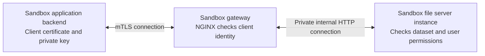

# How mTLS Works in This File Server

This is a simple explanation of the [proposed architecture](./mtls-based-architecture.md),
using the same names, certificates, and settings as the
[implementation guide](./implementation-guide.md).

**Status:** these are proposed configuration examples. The application does not yet implement
the complete design. Use the implementation guide when making the code and deployment changes.

## 1. Start with the example we want to support

Suppose `sandbox-demo` is a sandbox-only dataset containing `sample.csv`.

- An ordinary client uses `https://files.example.com`, the **normal file server endpoint**.
  That file server instance must reject requests for `sandbox-demo`.
- The **sandbox application backend** uses `https://sandbox-files.example.com`, the
  **sandbox file server endpoint**. It must present its client certificate and prove it holds
  the matching private key.
- After accepting that client identity, the **sandbox file server instance** must still check
  whether the user or service has permission to download `sandbox-demo`.

The sandbox application backend requests the file. The sandbox file server instance serves it.
They are separate applications.

## 2. What mTLS adds to HTTPS

TLS protects a connection. HTTPS uses TLS for HTTP requests. Mutual TLS, or **mTLS**, adds
certificate authentication of the client as well as the server.

| Connection | Certificate checks |
| --- | --- |
| Ordinary HTTPS | The client verifies the server's certificate and hostname |
| HTTPS with mTLS | The client verifies the server; the server also verifies the client's certificate and proof of its private key |

For our example, the two sides establish:

```text
Sandbox application backend:
  "I am connecting to the trusted server for sandbox-files.example.com."

Sandbox gateway:
  "This client has an accepted certificate for CN=sandbox-client
   and holds the matching private key."
```

The certificate contains public identity information. The private key stays with its owner.
TLS uses cryptographic proof of that key; the client does not send the private key to the server.
The TLS 1.3 specification describes this proof in
[CertificateVerify](https://www.rfc-editor.org/rfc/rfc8446.html#section-4.4.3).

## 3. The certificate files and who needs them

A **certificate authority**, or **CA**, signs certificates. Each side is configured with a CA
certificate that it trusts to verify the other side's certificate.

Our lab examples use two CAs so that server trust and client trust are easy to distinguish:

| File from the implementation guide | Who uses it | Purpose |
| --- | --- | --- |
| `server.crt` | Normal and sandbox gateways | Identifies the server; the lab certificate covers both example hostnames |
| `server.key` | Normal and sandbox gateways | Secret key matching `server.crt` |
| `server-ca.crt` | Sandbox application backend | Lets the client verify the lab server certificate |
| `sandbox-client.crt` | Sandbox application backend | Identifies the client as `CN=sandbox-client` |
| `sandbox-client.key` | Sandbox application backend | Secret key matching the client certificate |
| `client-ca.crt` | Sandbox gateway | Lets the gateway verify who issued the client certificate |

`CN=sandbox-client` is the example certificate's **subject**, or identity name. The gateway
and application allow that exact subject. A certificate from the trusted client CA with a
different subject is still rejected by the example's identity allow-list.

The CA private keys, `server-ca.key` and `client-ca.key`, stay with the certificate issuer.
The running client and gateways only need the files listed above.

The implementation guide mounts `server.crt` and `server.key` through a Kubernetes TLS Secret.
Inside the gateway container, they appear as `/etc/nginx/tls/tls.crt` and
`/etc/nginx/tls/tls.key`. These are the same certificate and key with the Secret's filenames.

## 4. Where mTLS happens in this design

The **sandbox gateway** is the NGINX reverse proxy in front of the sandbox file server instance.
It performs the client-certificate checks and forwards accepted requests to the application.



In the guide's Kubernetes examples, an external TCP load balancer forwards port 443 to the
gateway's TLS listener on port 8443. It leaves certificate verification to NGINX. The gateway
then forwards to the `files-connect-api-sandbox` Service on port 80, which targets application
port 3000.

The client-to-gateway connection is encrypted with TLS. The internal application connection in
this example uses HTTP and is restricted by network policy; use internal TLS or a service mesh
if that part of the network also needs encryption.

This is why the application can keep its HTTP listener in
[server.ts](../../src/server.ts). The gateway handles mTLS in this deployment model.

## 5. Follow one successful download

The following diagram simplifies the certificate exchange; it is not an exact TLS packet trace.

```mermaid
sequenceDiagram
    participant Client as Sandbox application backend
    participant Gateway as Sandbox gateway
    participant API as Sandbox file server instance

    Client->>Gateway: Start connection to sandbox-files.example.com
    Gateway-->>Client: Server certificate; request a client certificate
    Note over Client: Verify server CA, hostname, and certificate validity
    Client->>Gateway: Client certificate and proof of matching private key
    Note over Gateway: Verify client certificate and allowed subject
    Note over Client,Gateway: mTLS connection is ready

    Client->>Gateway: POST download request with bearer token
    Gateway->>API: Forward request with verified client identity
    Note over API: Validate token, load dataset type, and check dataset permission
    API-->>Gateway: File content, only if all checks pass
    Gateway-->>Client: File content over the mTLS connection
```

There are three separate checks:

| Check | Example question it answers |
| --- | --- |
| mTLS client identity | Is this an accepted sandbox application backend? |
| JWT authentication | Which user or service is requesting the file? |
| Dataset authorization | Does that user or service have permission to download `sandbox-demo`? |

The file server also checks the Catalogue's dataset type. For sandbox-only data, it requires
the sandbox file server path even when the user already has dataset permission.

## 6. The gateway configuration, explained

These are selected lines from the full sandbox NGINX configuration in
[Step 9 of the implementation guide](./implementation-guide.md#step-9-configure-separate-https-and-mtls-gateways).
They belong inside its `server` block:

```nginx
ssl_certificate /etc/nginx/tls/tls.crt;
ssl_certificate_key /etc/nginx/tls/tls.key;
ssl_client_certificate /etc/nginx/client-ca/ca.crt;
ssl_verify_client on;
```

| Setting | Plain meaning |
| --- | --- |
| `ssl_certificate` | The server certificate the gateway presents to clients |
| `ssl_certificate_key` | The gateway's secret key matching that certificate |
| `ssl_client_certificate` | The CA certificates used to verify incoming client certificates |
| `ssl_verify_client on` | Require a verified client certificate |

The full example also allows only the subject `CN=sandbox-client`. Requiring a trusted issuer
and selecting an allowed client identity are both part of the gateway's configuration.

Once verification succeeds, the gateway overwrites these headers with its own results:

```nginx
proxy_set_header X-Sandbox-Client-Verify $ssl_client_verify;
proxy_set_header X-Sandbox-Client-DN $ssl_client_s_dn;
```

For our accepted client, the application receives:

```http
X-Sandbox-Client-Verify: SUCCESS
X-Sandbox-Client-DN: CN=sandbox-client
```

`DN` means distinguished name: the certificate subject in a defined text format. NGINX's
[SSL module documentation](https://nginx.org/en/docs/http/ngx_http_ssl_module.html) describes
these verification settings and variables.

These headers are the gateway's report of a check it performed. A client typing the same
headers into Postman has not performed mTLS. The gateway replaces incoming values, and
network policy permits only the sandbox gateway to reach the sandbox file server instance.
Both protections are required before the application can trust those headers.

## 7. The sandbox client's configuration, explained

The sandbox application backend needs its certificate, matching private key, and server CA.
This is the same Node.js HTTPS agent used in the implementation guide:

```typescript
import https from 'node:https';
import { readFileSync } from 'node:fs';

const agent = new https.Agent({
  cert: readFileSync('/run/sandbox-mtls/sandbox-client.crt'),
  key: readFileSync('/run/sandbox-mtls/sandbox-client.key'),
  ca: readFileSync('/run/sandbox-mtls/server-ca.crt'),
  rejectUnauthorized: true,
});
```

| Option | Plain meaning |
| --- | --- |
| `cert` | Present this client identity to the gateway |
| `key` | Use this secret key to prove the client owns that identity |
| `ca` | Trust this CA when verifying the lab server certificate |
| `rejectUnauthorized: true` | Reject a server that fails certificate verification |

Pass that agent when sending the download request:

```typescript
import axios from 'axios';

async function downloadSample(accessToken: string) {
  const response = await axios.post(
    'https://sandbox-files.example.com/v1/databanks/sandbox-demo/files/download',
    { key: 'sample.csv', presigned: false },
    {
      httpsAgent: agent,
      headers: { Authorization: `Bearer ${accessToken}` },
      responseType: 'stream',
      maxRedirects: 0,
      timeout: 30000,
    },
  );
  return response.data;
}
```

The function returns a stream for the sandbox application to process or save inside its own
environment. The certificate is configured on the HTTPS connection, while the bearer token
is part of the HTTP request. Keep the client key inside the sandbox backend.

The explicit `ca` here is for our lab certificates. A server using a publicly trusted certificate
can use the platform's normal CA trust instead. These connection options are documented in the
[Node.js HTTPS API](https://nodejs.org/api/https.html#httpsrequestoptions-callback).

## 8. The file server settings, explained

The implementation guide proposes these application settings:

```dotenv
FILE_SERVER_MODE=sandbox
SANDBOX_ALLOWED_CLIENT_SUBJECTS=CN=sandbox-client
AUTH_ENABLED=true
AUTHZ_ENABLED=true
```

| Setting | Plain meaning |
| --- | --- |
| `FILE_SERVER_MODE=sandbox` | This deployment is the sandbox file server instance |
| `SANDBOX_ALLOWED_CLIENT_SUBJECTS` | Accept only these verified client subjects from the trusted gateway |
| `AUTH_ENABLED=true` | Validate the caller's JWT |
| `AUTHZ_ENABLED=true` | Check the caller's roles/scopes and dataset permission |

The normal file server instance uses `FILE_SERVER_MODE=normal`. Its rule for sandbox-only data
is always “deny.” An incoming header cannot switch it into sandbox mode.

The settings above do not create TLS certificates or configure NGINX. Gateway configuration
establishes client identity; application settings enforce how the file server uses that identity.

For our sample download, the final rule is:

```text
Dataset: sandbox-demo
Type: sandbox-only

Required:
  sandbox file server instance
  + verified, allowed sandbox client identity
  + valid caller token and required roles/scopes
  + permission to download sandbox-demo
```

The implementation guide uses `SANDBOX_ONLY` as an example Catalogue value for this type.
Confirm the actual Catalogue value before implementing the adapter.

## 9. Compare successful and rejected requests

| Request | Result |
| --- | --- |
| Allowed user asks the normal file server instance for `sandbox-demo` | `403`: sandbox-only data requires the sandbox file server instance |
| Local Postman calls the sandbox gateway without a client certificate | Gateway rejects it before forwarding to the application |
| Client has `sandbox-client.crt` but no matching private key | Cannot complete the required client authentication |
| Client has a certificate from an unrelated CA | Gateway rejects it |
| Client has a trusted certificate for a different subject | Identity allow-list rejects it |
| Accepted sandbox client has an invalid/expired bearer token | Application authentication rejects it |
| Accepted sandbox client has a valid token but lacks dataset permission | Application authorization rejects it |
| Accepted sandbox client has a valid token and dataset permission | File content returns through the mTLS endpoint |

For a concrete lab call, use the certificate directory created in Step 8 of the implementation
guide and a valid test token in `ACCESS_TOKEN`:

```bash
curl --fail-with-body \
  --cacert "$MTLS_WORKDIR/server-ca.crt" \
  --cert "$MTLS_WORKDIR/sandbox-client.crt" \
  --key "$MTLS_WORKDIR/sandbox-client.key" \
  -H "Authorization: Bearer $ACCESS_TOKEN" \
  -H 'Content-Type: application/json' \
  -d '{"key":"sample.csv","presigned":false}' \
  -o "$MTLS_WORKDIR/downloaded-sample.csv" \
  'https://sandbox-files.example.com/v1/databanks/sandbox-demo/files/download'
```

`--cacert` verifies the server. `--cert` and `--key` authenticate the client. The Authorization
header supplies the separate caller token. Replace `sandbox-demo` and `sample.csv` with your
synthetic test fixture, and configure DNS or `--resolve` as described in the implementation guide.

Removing `--cert` and `--key` should cause rejection at the gateway. Depending on the gateway
and TLS version, that may appear as a TLS failure or a gateway HTTP error. In either case, no
request should reach the file server application.

A local Postman or curl client supplied with the accepted certificate **and its private key**
can authenticate as that client. mTLS checks credentials, not physical location or an HTTP
`Origin` value. This is why keeping the client key inside the sandbox application matters.

## 10. Keep the actual download on the protected path

For sandbox-only files, `presigned: false` means the file server returns file content through
the endpoint that performed these checks:

```text
Private object storage
  → sandbox file server instance
  → sandbox gateway
  → sandbox application backend
```

A presigned URL is a temporary link for downloading directly from storage. If it works outside
the sandbox, obtaining that link through mTLS would not protect the later download. That is why
the proposed implementation rejects `presigned: true` and direct storage credentials for
sandbox-only datasets, and applies the same restrictions to previews and protected outputs.

For the full code changes, certificates, Kubernetes configuration, and verification checklist,
continue with the [implementation guide](./implementation-guide.md).
